# MacDualMiner – macOS Crypto Miner for Apple Silicon

MacDualMiner is a free, open-source **macOS crypto miner** for Apple Silicon Macs (M1, M2, M3, M4 and M5). It's a lightweight native app that mines on **both halves of an Apple Silicon chip at once**, with a **NiceHash-like style and interface**: one big Start button, live profitability, per-device controls and automatic switching to the most profitable coin. It runs on any M1–M5 Mac with macOS 15 or later and is tuned for the **M5 Max**. It runs four engines and **automatically picks the most profitable coin for each part of the chip**.

**Full guide with screenshots, setup and real M5 Max results:** [MacDualMiner on cryptominingonmacs.com](https://cryptominingonmacs.com/viewtopic.php?t=170)

| Engine | Part of the chip | Algorithm | Coins in the profit check | How it ships |
|---|---|---|---|---|
| [XMRig](https://github.com/xmrig/xmrig) | CPU | RandomX, GhostRider | Monero, Tari, Zephyr, QRL, Epic Cash, Etica, Raptoreum | Bundled (official release, SHA-256 verified) |
| [kawpow-metal](https://github.com/imperatormk/kawpow-metal) | GPU (Metal) | KawPow | Ravencoin, Quai, Neoxa, Neurai, Kerrigan | Bundled (built from a pinned commit) |
| [ethminer-m1](https://github.com/gyf304/ethminer-m1) | GPU (OpenCL) | Ethash | EthereumPoW, OctaSpace, QuarkChain | Bundled (release binary, pinned SHA-256) |
| [UselethMiner](https://github.com/Chainfire/UselethMiner) | CPU + GPU | Ethash | EthereumPoW | Optional in-app download (closed source, 1% fee) |

Engine choices and reference hashrates come from the Mac tests on [cryptominingonmacs.com](https://cryptominingonmacs.com/viewtopic.php?t=135). On the M5 Max those tests measured XMRig at 9.0 kH/s, ethminer-m1 at 41.6 MH/s and KawPow at 14.4 MH/s ([t=169](https://cryptominingonmacs.com/viewtopic.php?t=169)).

> **Reality check:** a Mac is not a profitable mining rig. Expect cents per day, and possibly a net loss once electricity is included. The earnings tab and the profit check are built to show that honestly. Mining also keeps the chip hot and fans busy for as long as it runs.

---

## Screenshots

Real numbers from a 2026 MacBook Pro 16" with an M5 Max (18-core CPU, 40-core GPU, 128 GB) at $0.17/kWh electricity, using the Mac's measured power. Shown in Light mode; Dark mode is one click away in Settings. More guides and hashrate tests: [cryptominingonmacs.com](https://cryptominingonmacs.com).

**Dashboard.** Live profitability after electricity, both parts of the chip with their coin, engine, hashrate, watts and shares, and the power vs earnings chart. Each part of the chip has its own coin menu and Start/Stop button. Here only the CPU is started: Monero at about 84 W measured above idle, slightly in the red at $0.17/kWh, and the note under the CPU says so. The GPU is stopped and shows the coin it would mine.

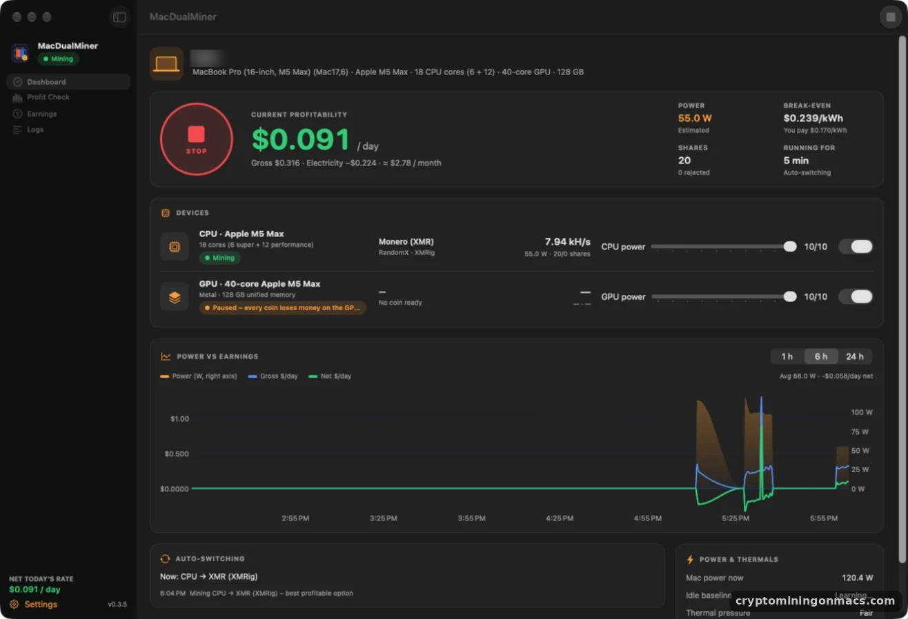

**Power & Thermals.** Measured power, the learned idle baseline, and chip and battery temperature in °F or °C.

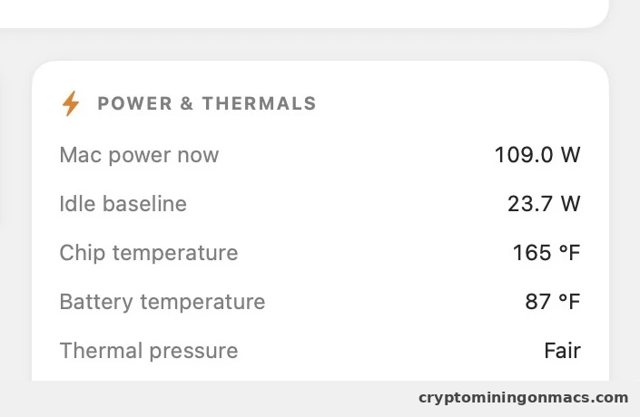

**Profit Check.** Every coin the bundled engines can mine, ranked by net USD per day, with its algorithm, engine, your hashrate (live, benchmarked on this Mac, or the cryptominingonmacs.com reference), coins mined per day, 24h trading volume and whether it's ready to mine.

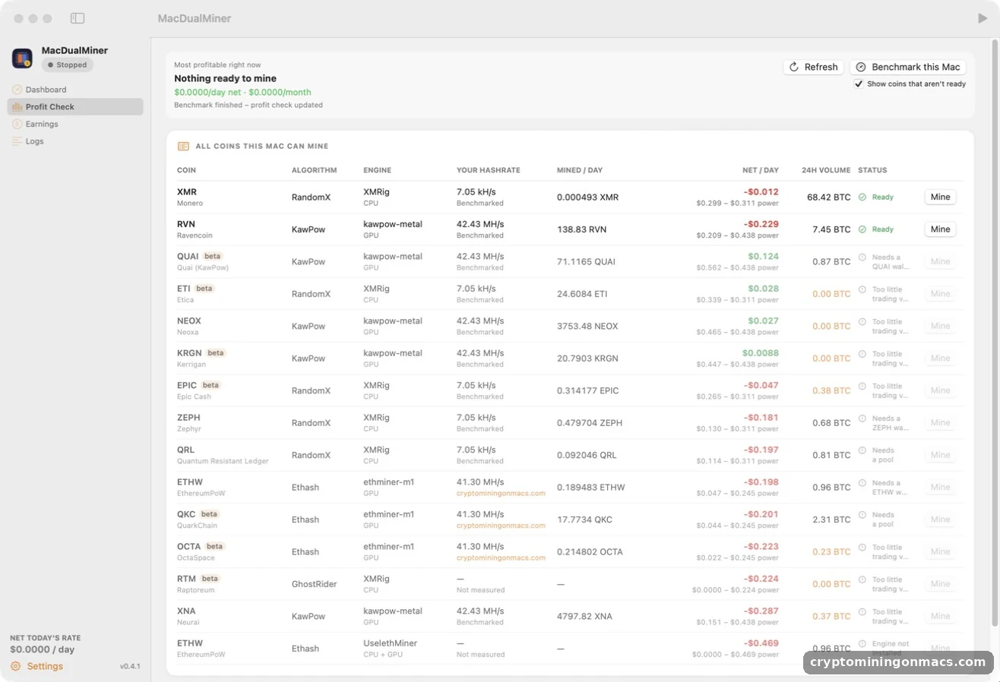

| | |
|---|---|
| 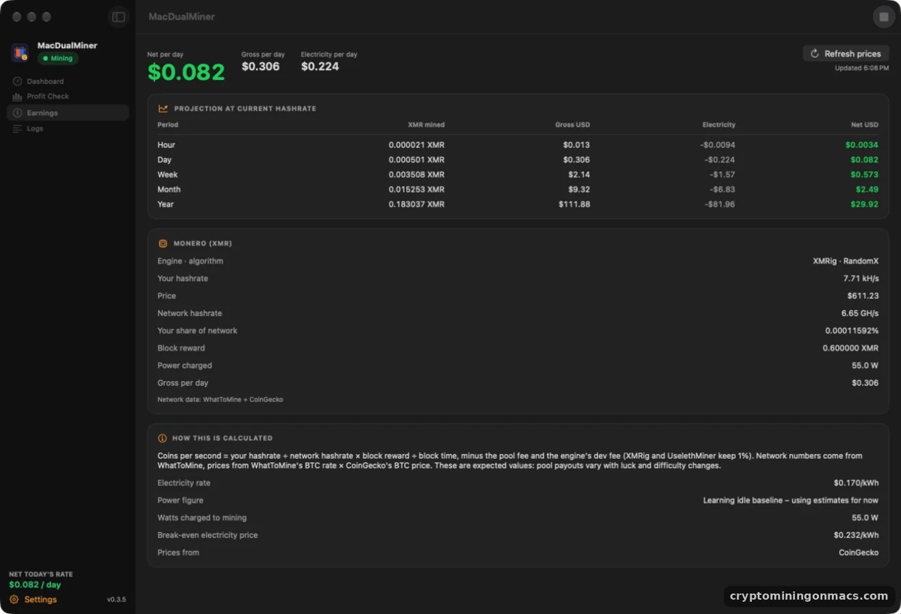<br>**Earnings.** Gross, electricity and net per hour, day, week, month and year, and how it's calculated. | 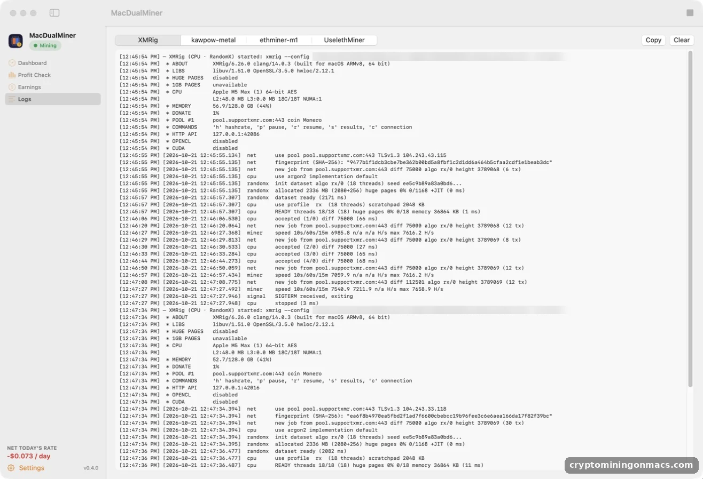<br>**Logs.** Each engine's own output: accepted shares and the hashrate the miner reports. |

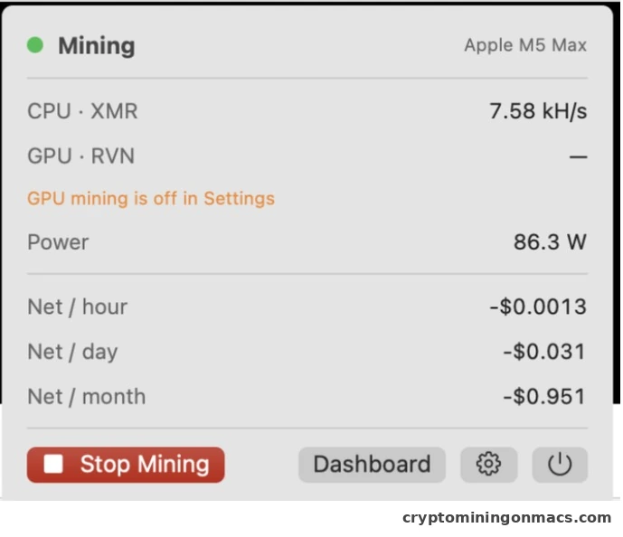

**Menu bar.** Start or stop mining and watch earnings without opening the window.

### Settings

| | |
|---|---|
| 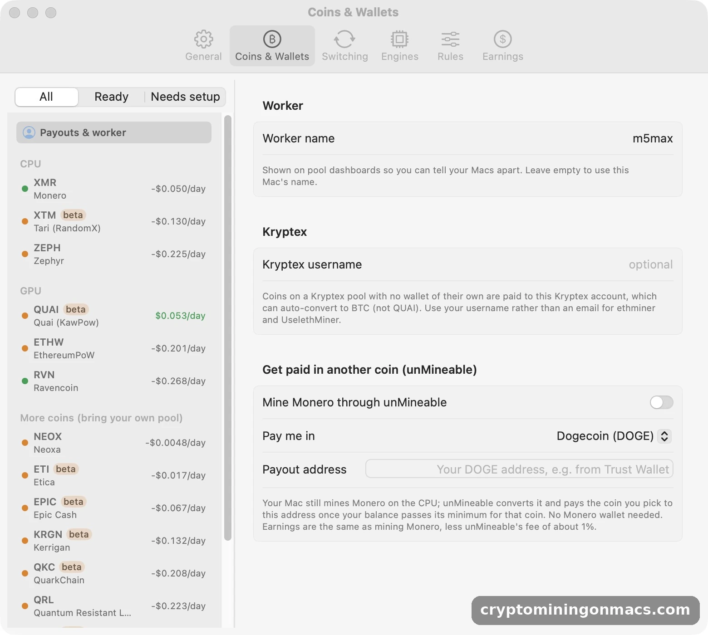<br>**Coins & Wallets.** A list of coins (CPU, GPU, bring your own pool) with ready status and net per day; a wallet and pool per coin, plus Kryptex and unMineable payouts. | 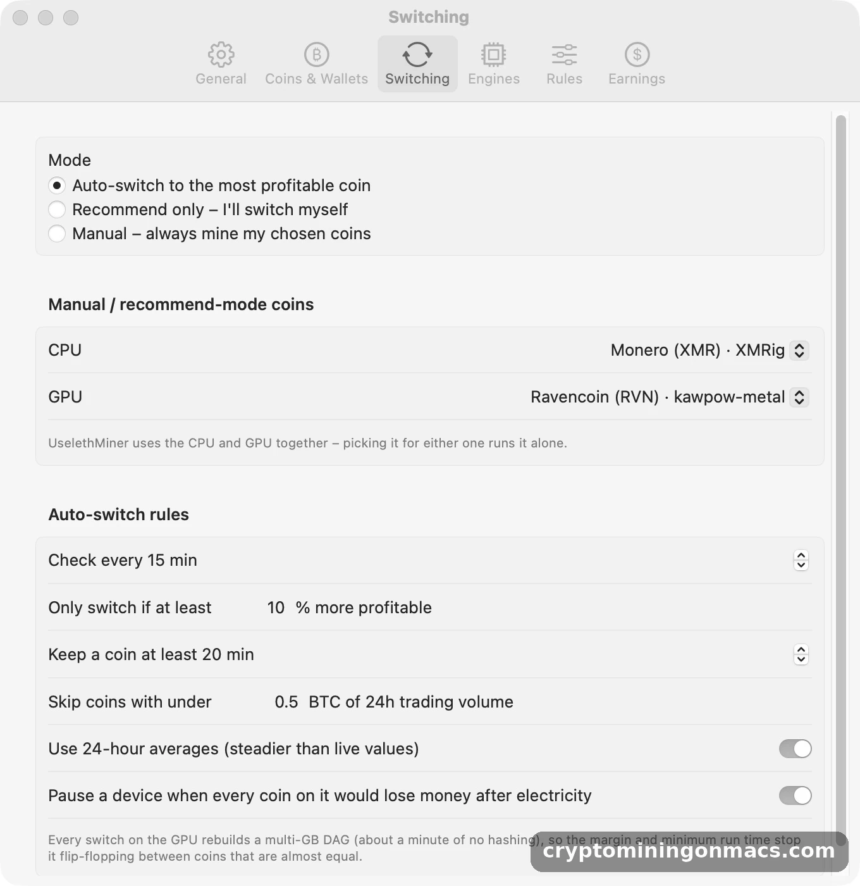<br>**Switching.** Auto, recommend-only or manual, with a switch margin, minimum run time, trading-volume filter and an option to keep a device idle when every coin would lose money. |
| 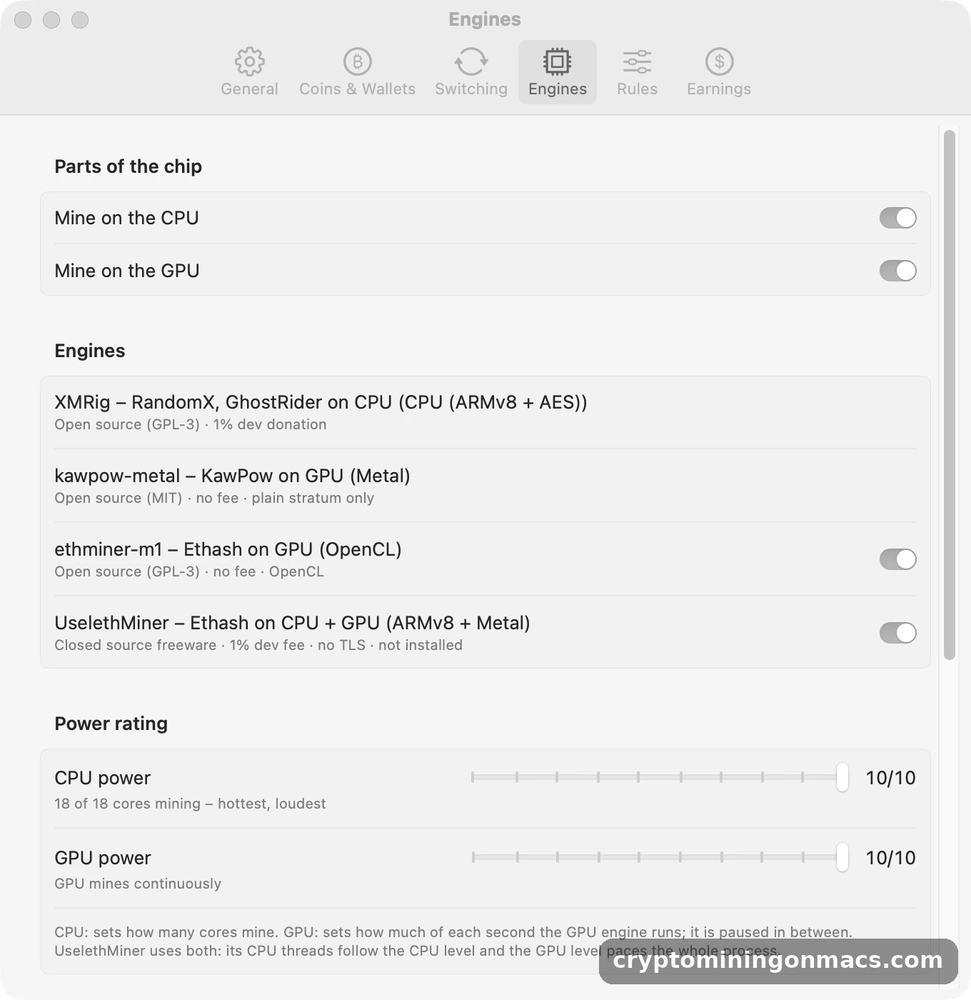<br>**Engines.** Turn the CPU, GPU and each engine on or off, and set separate 1–10 power ratings. | 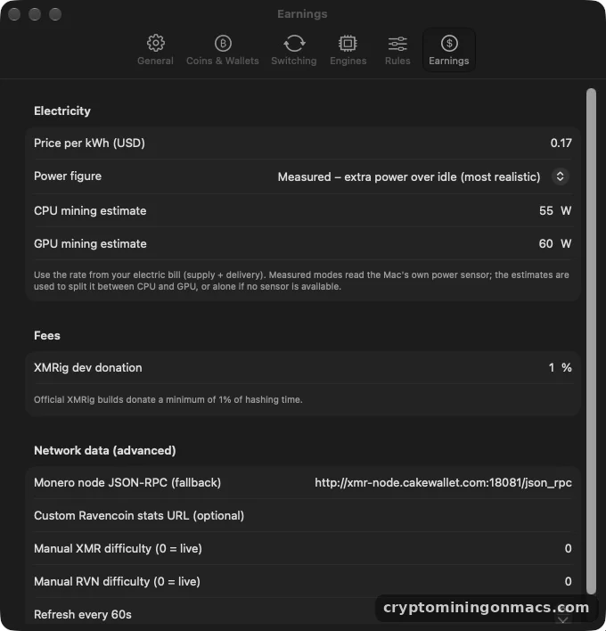<br>**Earnings.** Your electricity price and how power is measured. |
| 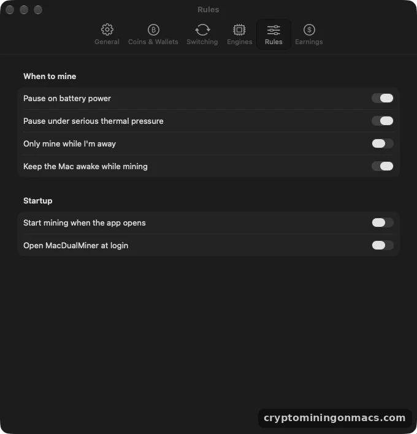<br>**Rules.** Pause on battery or under thermal pressure, mine only while you're away, start at login. | 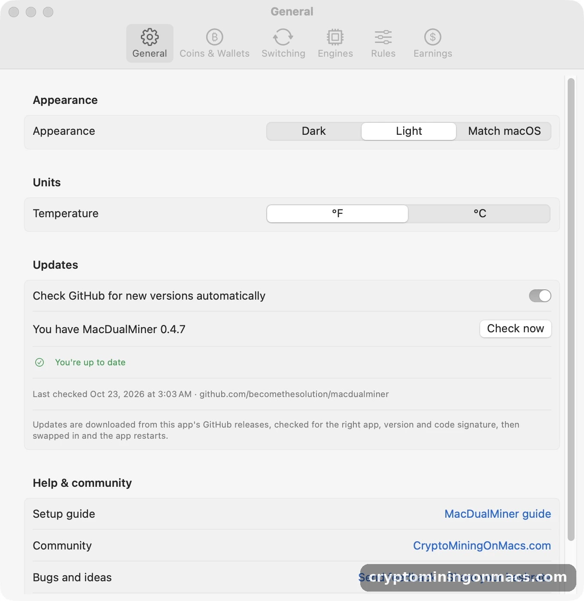<br>**General.** Dark, Light or Match macOS appearance, and the update check, which installs new GitHub releases after verifying them. |

Measured on the M5 Max: XMRig does about 7.0–7.9 kH/s with the CPU alone (about 76–91 W above idle) and 3–4 kH/s while the GPU also mines; kawpow-metal does about 42–46 MH/s with the GPU alone (about 107 W) and 31–33 MH/s while the CPU also mines. At $0.17/kWh, Monero and Ravencoin both lose a little money after electricity on this Mac, and MacDualMiner shows that up front instead of hiding it. Personal details (wallet address, Mac name, user folder) are blurred.

## Features

- **NiceHash-like interface:** a sidebar, a large Start All / Stop All button with live profitability, and one row per device (CPU and GPU) showing coin, algorithm, engine, hashrate, watts and shares, with a coin menu, a power slider and its own Start/Stop button. It also shows your Mac's own name, model and chip details, and comes in a Dark or Light look, or follows macOS (Settings › General).
- **Power vs Earnings chart:** power draw against gross and net $/day over the last 1, 6 or 24 hours. A point is recorded every 30 seconds and the history is kept between launches; hover to read exact values.
- **Temperatures:** chip and battery temperature under Power & Thermals, in °F or °C.
- **Setup assistant:** on first launch, three steps – electricity price, where to get paid, benchmark.
- **Pool balance:** the Dashboard shows your unpaid balance at Kryptex, unMineable, SupportXMR and 2Miners, and how close each is to paying out.
- **Get paid in another coin:** mine Monero through unMineable and get paid in Dogecoin, Litecoin, Bitcoin, Tron, Solana and more, straight to a Trust Wallet (or any) address. No Monero wallet needed.
- **Auto-switch per chip:** CPU and GPU auto-switch toggles in the Auto-switching panel. Off keeps that chip on its current coin; on lets it switch to the best coin again.
- **Pick a coin per chip:** the coin under the CPU and GPU on the Dashboard is a menu: Auto (best coin) or any coin that chip can mine, with its net per day. Picking one pins just that chip (UselethMiner uses both chips, so it pins both).
- **Start All or one at a time:** Start All Miners, or start and stop the CPU and GPU separately from their rows on the Dashboard. Start always mines: when nothing is profitable at your electricity price, auto mode mines the least costly coin and a note under the device says so (or keep the device idle with a setting in Switching).
- **Feedback from the app:** Help › Send Feedback… and Help › Share Your Hashrate… open a GitHub issue with the app version, Mac model, chip and macOS version already filled in (your Mac's name is left out).
- **Help & community:** the Help menu, Settings › General and the sidebar link to the [MacDualMiner guide](https://cryptominingonmacs.com/viewtopic.php?t=170), the [CryptoMiningOnMacs.com](https://cryptominingonmacs.com/) community (the macOS crypto mining community) and GitHub Issues. Reference hashrates in Profit Check link to the tests they come from.
- **Update check:** looks for new GitHub releases at launch and every 6 hours, or right away from Help › Check for Updates…. *Install & Restart* downloads the release, checks it's the right app, version and code signature, swaps it in and relaunches.
- **Profit Check tab.** Every coin the engines can mine, with:
  - its **algorithm**
  - the **engine** and part of the chip it uses
  - **your hashrate** on that algorithm: live, benchmarked on this Mac, or the cryptominingonmacs.com reference for your chip
  - coins mined per day
  - **net USD/day** (gross minus electricity)
  - 24h trading volume
  - whether it's ready to mine

  Data comes from WhatToMine plus CoinGecko's BTC price. Coins too thinly traded to sell, coins with stale network data, and coins without a wallet or pool are flagged rather than picked.
- **Auto-switching.** The app picks the best CPU + GPU combination, or UselethMiner on both, and re-checks every 15 minutes. It switches only when the new plan is at least 10% better and the current coins have run for 20 minutes. All three thresholds are adjustable. The other modes are *Recommend*, which shows a "Switch" button, and *Manual*.
- **Benchmark this Mac.** Runs each installed engine for about 2 minutes on its best ready coin and records hashrate and power. Engines that mine steadily for 5 minutes also update their numbers automatically. Choose which engines it runs from the menu beside it, skip one while it runs, or right-click a coin to benchmark just that one.
- **Power rating 1–10 for CPU and GPU separately.**
  - CPU: the level sets how many cores mine.
  - GPU: the level sets how much of each second the GPU engine runs; it's paused and resumed in short bursts.
  - The profit check scales its hashrate and power estimates to these levels.
- **Payouts:** set a wallet per coin, or a single Kryptex account that receives every coin on a Kryptex pool (auto-convert to BTC is available for all except QUAI).
- **Dashboard and menu bar:**
  - The dashboard shows each part of the chip: coin, algorithm, engine, hashrate, shares, pool, status and power slider.
  - The menu bar shows live net $/day and offers any better plan.
- **Earnings tab:** live USD per hour, day, week, month and year for whatever is running. Electricity comes from the Mac's own power sensor (SMC `PSTR`) and, by default, counts only the extra watts above idle.
- **Rules:** pause on battery, pause under serious thermal pressure, mine only when idle, keep the Mac awake while mining, start on launch, open at login.
- **Robust:**
  - Engines restart with back-off if they crash.
  - Only the engines a change affects are restarted.
  - Leftover engine processes are cleaned up after a crash.
  - Every bundled binary is checksum-verified at build time.

## Requirements

**To run the app**

- An Apple Silicon Mac: any M1, M2, M3, M4 or M5 chip. Intel Macs are not supported, because the app and all its engines are arm64-only.
- macOS 15 Sequoia or later. The KawPow GPU engine needs macOS 15.
- About 3 GB of free memory for CPU mining (XMRig's RandomX dataset is ~2.3 GB). GPU mining needs more: about 5 GB for KawPow and 7–8 GB for Ethash, because their DAGs grow over time.
- Wallet addresses for the coins you want to mine (from wallets you control), or a Kryptex account.
- An internet connection, for the pools, WhatToMine network data and coin prices.

**To build it yourself**

- Xcode, or just the Command Line Tools (`xcode-select --install`).

## Compatibility

| | M1 / M2 / M3 / M4 family | M5 | M5 Pro / M5 Max |
|---|---|---|---|
| App, dashboard, profit check | ✅ | ✅ | ✅ |
| XMRig – CPU (RandomX, GhostRider) | ✅ | ✅ | ✅ tested on M5 Max (9.0 kH/s) |
| kawpow-metal – GPU (KawPow) | ✅ listed by its author | ⚠️ not tested yet | ✅ runs on M5 Max |
| ethminer-m1 – GPU (Ethash) | ✅ | ✅ | ✅ tested on M5 Max (41.6 MH/s) |
| UselethMiner – CPU + GPU (Ethash) | ✅ tested up to M4 Max | ⚠️ not tested yet | ✅ tested on M5 Max (~13–18 MH/s CPU + ~34 MH/s GPU) |
| Starting hashrates without a benchmark | M1 Ultra, M2, M2 Max, M3 Max, M3 Ultra, M4, M4 Max | – | M5 Max |

**What's tuned for M5:**

- CPU threads and the 1–10 power levels come from the detected 18-core layout (6 super + 12 performance).
- RandomX runs in fast mode, which suits the M5 Max's memory.
- The profit check starts from M5 Max hashrates measured on [cryptominingonmacs.com](https://cryptominingonmacs.com/viewtopic.php?t=169).

**What isn't:** the mining engines are general Apple Silicon builds. None of them is rewritten for M5-specific hardware such as the GPU's neural accelerators.

**Other Macs:** the app reads each Mac's own core counts, GPU and memory, so it works on any Apple Silicon Mac. On chips without a reference hashrate, click **Benchmark this Mac** on the Profit Check tab and the profit check uses your own numbers.

## Build & install

```bash
git clone https://github.com/<you>/MacDualMiner.git
cd MacDualMiner
INSTALL=1 scripts/build-app.sh      # builds build/MacDualMiner.app and copies it to /Applications
```

The build script:

1. Compiles the app with SwiftPM in release mode.
2. Downloads the official **XMRig** macOS arm64 release (version pinned in the script) and **verifies its SHA-256** against XMRig's published `SHA256SUMS`.
3. Clones **kawpow-metal** at a pinned commit and applies `scripts/patch_kawpow.py`. The patch lets it find its shader and cache files from inside an app bundle and makes its output line-buffered. It then builds it.
4. Assembles `MacDualMiner.app` with both engines in `Contents/Resources/engines/`, ad-hoc code-signs it, and zips it.

Override the pinned versions with environment variables, e.g. `XMRIG_VERSION=6.26.0 KAWPOW_COMMIT=<sha> scripts/build-app.sh`.

Run the unit tests (earnings maths, parsers, config generation) with `swift test`.

### Publishing a release

Releases are built on a Mac, not on GitHub Actions. From a clean, up-to-date checkout of `main`, bump `VERSION`, commit and push, then run:

```bash
scripts/release.sh               # tests, builds, saves to the "MacDualMiner Builds" folder (~/Desktop/BUILDZ/MacDualMiner Builds/<version>/), publishes v<version>
INSTALL=1 scripts/release.sh     # same, and installs the new build to /Applications
DRY_RUN=1 scripts/release.sh     # build and save only, publish nothing
```

If the GitHub CLI (`gh`) is installed and signed in, the script publishes the release itself. Without it, the script still builds and saves everything and prints the link to publish the zip on the Releases page in a browser. The in-app updater picks up the new release automatically.

## First run

1. Open **MacDualMiner** and go to **Settings (⌘,) › Coins & Wallets**.
2. Pick a coin in the list and paste a wallet address for it. Alternatively, under **Payouts & worker**, enter a **Kryptex username** once (every coin on a Kryptex pool becomes eligible: Monero, Zephyr, EthereumPoW, Quai), or turn on **Mine Monero through unMineable** to be paid in Dogecoin, Litecoin, Bitcoin and others to a Trust Wallet (or any) address.
3. Coins without a preset pool (QRL, Neoxa, Neurai, …) need a custom pool, entered under the coin.
4. **Settings › Earnings**: set your electricity price per kWh from your bill.
5. Optional: under **Settings › Engines**, click *Download & install* for UselethMiner.
6. Open the **Profit Check** tab and click **Benchmark this Mac** so the ranking uses this Mac's real hashrates. Until then it uses the cryptominingonmacs.com result for your chip.
7. Press **Start All Miners** (or start the CPU or GPU on its own from its row). In Auto mode the app runs the best plan and keeps re-checking.

What to expect on first start:

- XMRig spends about 10–30 seconds building its 2 GB RandomX dataset.
- GPU engines build a multi-GB DAG first (about a minute).
- UselethMiner's first DAG load can take a few minutes.

## How the earnings maths works

```
coins/sec = your_hashrate / hashes_per_block × block_reward × (1 − pool_fee) × (1 − dev_fee)
  Monero:    hashes_per_block = difficulty
  Ravencoin: hashes_per_block = difficulty × 2³²
USD/sec    = coins/sec × live_price
power/sec  = watts / 1000 / 3600 × $/kWh
net        = Σ USD − power      (then × 3,600 / 86,400 / 604,800 / 2,629,800 / 31,557,600)
```

These are expected values. Actual pool payouts vary with luck and difficulty swings, and pools hold coins until you reach their minimum payout.

## Notes & limitations

- **kawpow-metal** is a small, young project. Its README lists M1–M4, so M5 Max support is untested upstream. If the GPU side misbehaves, turn GPU mining off and the CPU side keeps going.
- Network-data endpoints are public third-party APIs and can change. If one breaks, the app tries the next. You can also set a custom Ravencoin stats URL or enter difficulty manually under Settings › Earnings.
- `NSAllowsArbitraryLoads` is enabled so the XMRig local API and plain-HTTP Monero node fallbacks work.
- Official XMRig builds donate a minimum of 1% of hashing time to the XMRig developers. The calculator accounts for this.

## Repository layout

```
Sources/MacDualMiner/
  MacDualMinerApp.swift      App, menu bar, crash clean-up
  MiningCoordinator.swift    Start/stop, auto-switching, pause rules, benchmarks, power allocation, earnings
  Model/CoinCatalog.swift    Coins per algorithm, engines, pool presets
  Model/ReferenceHashrates   cryptominingonmacs.com results per chip
  Engines/                   MinerProcess (runner + GPU duty cycle), XMRig, kawpow, ethminer, UselethMiner, installer
  Earnings/                  Earnings maths, WhatToMine data, profit planner
  System/                    SMC power sensor, battery, thermal, idle time
  Views/                     Dashboard, Profit Check, Earnings, Logs, Settings, menu bar
scripts/build-app.sh         Fetch + verify + build engines, assemble .app
scripts/patch_kawpow.py      Makes kawpow-metal bundle-friendly
scripts/release.sh           build on this Mac, save to ~/Desktop/BUILDZ/MacDualMiner Builds, publish the GitHub release
```

## More guides

Mac mining results, engine tests and guides: **[cryptominingonmacs.com](https://cryptominingonmacs.com)**.

MacDualMiner is an independent project. It is not affiliated with or endorsed by NiceHash; the name is used only to describe the style of the interface.

## FAQ

### Can you mine crypto on a Mac?
Yes. Apple Silicon Macs can mine CPU coins like Monero (RandomX) with XMRig, and GPU coins like Ravencoin and Quai (KawPow) with kawpow-metal, which runs on the GPU through Metal. MacDualMiner runs both, and picks which coin each part of the chip should mine.

### What's the best crypto miner for M1, M2, M3, M4 or M5 Macs?
It depends on the coin and your electricity price. XMRig is the fastest CPU miner on Apple Silicon, and kawpow-metal is the fastest KawPow miner (about 42–46 MH/s on an M5 Max, roughly three times MacMiner). MacDualMiner bundles both and benchmarks them on your own Mac. Hashrates for every M-series chip are on [cryptominingonmacs.com](https://cryptominingonmacs.com).

### Is crypto mining on a Mac profitable?
Usually not at typical US electricity prices. On an M5 Max at $0.17/kWh, with the Mac's measured power, Monero on the CPU comes out at roughly break-even to −$0.07/day and Ravencoin on the GPU at about −$0.23/day. Quai on the GPU was about +$0.12/day, but it needs a Quai wallet or Kryptex account. That's why MacDualMiner shows earnings after electricity and tells you under each device when it's mining at a loss, so you decide. You can also have it keep a device idle until a coin is profitable. With cheap or solar power the numbers look better.

### Is there a NiceHash for Mac?
NiceHash's own mining software is made for Windows and its Linux-based NiceHash OS, not macOS. MacDualMiner gives a similar experience on a Mac (one Start button, profitability ranking, automatic switching), but you mine directly to your own wallets on regular pools. It isn't affiliated with NiceHash.

### Can XMRig use the Mac's GPU?
No. XMRig's GPU backends are OpenCL and CUDA, and RandomX doesn't benefit from the Apple GPU, so XMRig mines on the CPU only. For the GPU, MacDualMiner uses kawpow-metal (Metal) or ethminer-m1 (OpenCL).

For setup, configuration and real results, see the [full MacDualMiner guide](https://cryptominingonmacs.com/viewtopic.php?t=170).

## Disclaimer

MacDualMiner is provided as is, without warranty of any kind. Mining keeps your Mac's CPU and GPU under heavy, sustained load. This raises temperatures, fan use and power consumption, and over time may add wear to your hardware, especially the battery on laptops. Earnings are estimates: coin prices, network difficulty and pool payouts change, and mining can cost more in electricity than it earns. You're responsible for your Mac, your electricity costs, and any taxes or local rules that apply to mining.

## License

Copyright © 2026 Become the Solution, LLC.

MacDualMiner is free, open-source software licensed under the **GNU General Public License v3.0** (see `LICENSE`). You're free to use, study, change and share it. If you distribute a modified version, you have to release its source code under the same license and keep the copyright and license notices.

Versions 0.4.1 and earlier were released under the MIT license.

Bundled engines keep their own licenses: XMRig and ethminer-m1 are GPL-3.0 and kawpow-metal is MIT. See `THIRD_PARTY_NOTICES.md`.

## Trademarks

"MacDualMiner" and the MacDualMiner icon are trademarks of Become the Solution, LLC. The GPL covers the code, not the name or icon. If you publish a fork or a modified build, give it a different name and icon so people don't mistake it for the official app. You can still say it's "based on MacDualMiner." See `TRADEMARKS.md`.

The only official downloads are the [Releases page](https://github.com/becomethesolution/macdualminer/releases) of this repository. The app's built-in updater installs only releases from this repository after checking the app, the version and the code signature.
